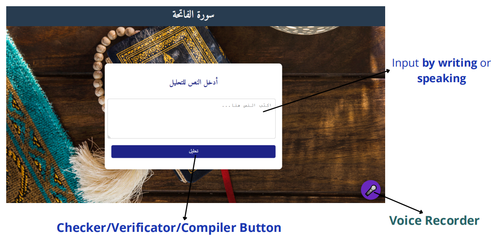
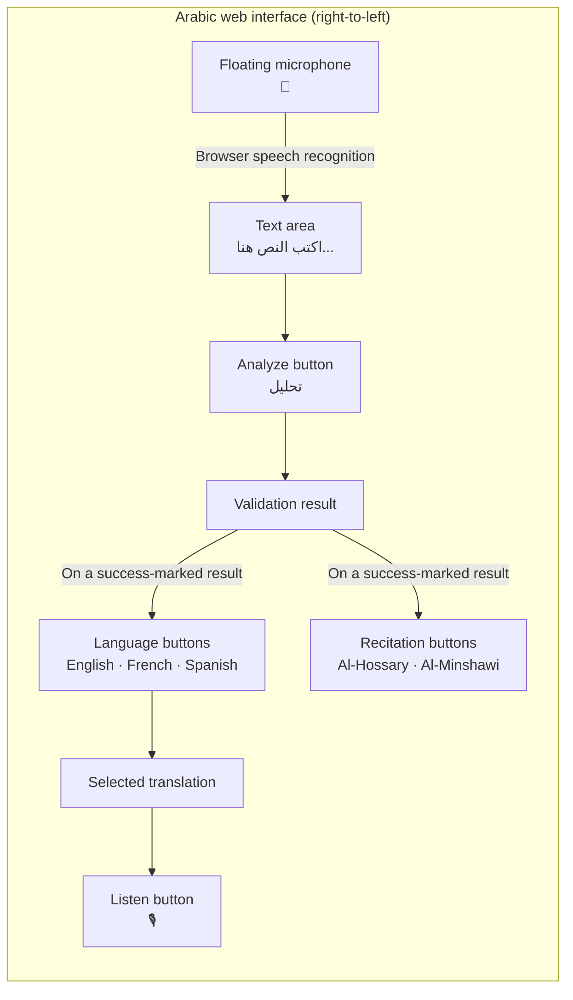
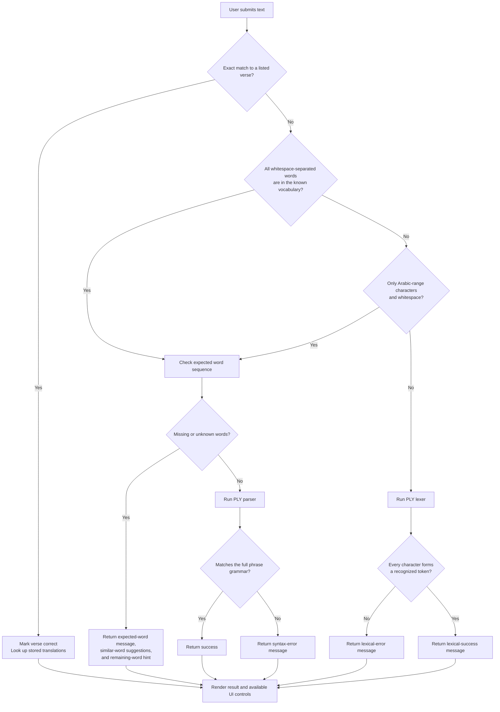
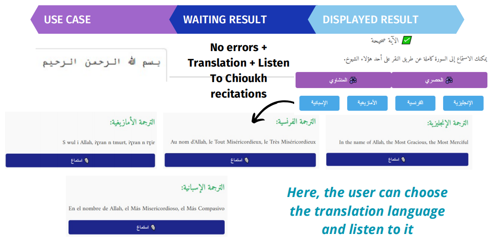
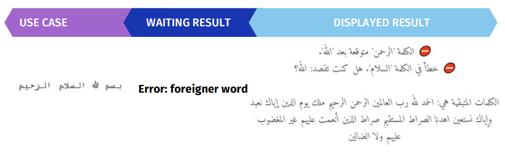
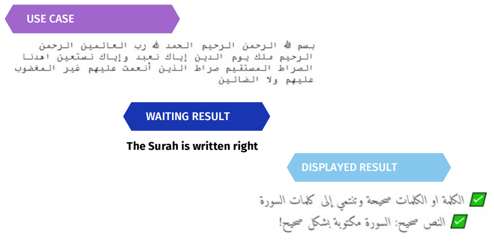

# Surat Al-Fatihah Compiler

A small Arabic-language web application that demonstrates compiler concepts by checking user-entered text against the vocabulary and word order of Surat Al-Fatihah. It uses a PLY lexer and parser behind a Flask interface, and provides verse translations and audio features in the browser.


## What it does

- Accepts Arabic text through a right-to-left web form.
- Recognizes words from the project's predefined Al-Fatihah vocabulary.
- Checks for expected words and word order, then applies a PLY grammar to the complete surah sequence.
- Reports lexical or syntax-related errors and may suggest similar known words.
- Provides stored English, French, and Spanish translations for the verse strings listed in the application.
- Offers browser speech recognition for dictation, browser text-to-speech for translations, and audio recitations by Al-Hossary and Al-Minshawi.

## Interface overview



The Flask template is an Arabic, right-to-left page. Its main interaction is a text area followed by **تحليل** ("Analyze"). The remaining controls are shown in the template and become available according to the result and browser behavior.



| Control | Behavior |
| --- | --- |
| Text area | Enter or edit Arabic text to analyze. |
| **تحليل** | Submits the form to the Flask `/` route using HTTP POST. |
| **🎤** | Starts or stops Arabic dictation using the browser Speech Recognition API, when supported. |
| English / French / Spanish | Selects a translation panel. The application contains fixed translations for its listed verse strings. |
| **🎙️ Listen** | Reads the displayed translation with the browser Speech Synthesis API, using the selected language. |
| **🎶 الحصري / 🎶 المنشاوي** | Plays the bundled recitation audio files. The interface also provides a stop/toggle behavior. |

The translation and recitation controls are initially hidden and are revealed by the page when the rendered result contains a success mark. Browser support is required for dictation and speech synthesis. Audio files are served locally from [src/static/](src/static/).

## Parsing methodology

The implementation combines regular-expression token rules, PLY's lexer/parser, and explicit word-level checks. The following flow follows the dispatch logic in [src/ALPHA.py](src/ALPHA.py); it distinguishes the exact-verse shortcut from the lexical and grammar path.



### Compiler stages

1. **Input preparation:** `analyser_chaine` removes a limited set of Arabic vowel/diacritic marks and splits the text on whitespace.
2. **Lexical analysis:** PLY `lex` maps recognized Arabic spellings to named tokens such as `BISM`, `ALLAH`, and `ALRAHEEM`. Whitespace and the configured diacritics are ignored. Any other character sequence triggers a lexical error.
3. **Vocabulary and sequence checks:** The application checks the expected word sequence and flags words not present in its known-word list. For an unknown word it uses Python's `difflib.get_close_matches` to offer up to three suggestions.
4. **Syntax analysis:** PLY `yacc` attempts to match the declared `phrase` production, which specifies the full ordered token sequence. The source also declares productions for individual verse-sized segments; the parser's default start rule is `phrase`.
5. **Result and logging:** The route renders the result in the page. If the result contains an error marker, the application appends the input, error messages, and available suggestions to [src/quran_analysis_log.txt](src/quran_analysis_log.txt) when launched from [src/](src/).

The direct verse check is a separate path: it compares submitted text with the strings in `versets_corrects`. It does not run the full lexer/parser pipeline before marking an exact listed verse correct.


*Case 1 : Right verse*


*Case 2 : Incorrect verse*

### Example full-surah input

The following unvowelled text follows the order used by the phrase grammar. It is a useful manual check of the intended full-phrase path:



For an exact verse-string input, the application returns the verse success response and fills in its stored translations. The translation dictionaries are not a general-purpose translation engine.

## Technology

- **Python** — application and validation logic.
- **Flask** — HTTP route and HTML template rendering.
- **PLY (Python Lex-Yacc)** — regular-expression lexer and grammar parser.
- **HTML/CSS/JavaScript** — Arabic right-to-left interface, browser speech APIs, and audio playback.

## Run locally

### Requirements

- Python 3
- `pip`
- A modern browser; browser speech recognition is optional and is not supported by every browser.

Install the Python packages:

```powershell
py -m venv .venv
.\.venv\Scripts\Activate.ps1
python -m pip install Flask ply
```

On macOS or Linux, activate the environment with `source .venv/bin/activate` instead.

Start the application from the `src` directory so the static files, template, and error log resolve relative to the project:

```powershell
cd src
python ALPHA.py
```

Open the local address printed by Flask in your browser (by default, `http://127.0.0.1:5000/`).

The application currently starts Flask with debug mode enabled. Use it for local development only; do not expose this development server to an untrusted network.


`parser.out` and `parsetab.py` are PLY-generated parser artifacts. `quran_analysis_log.txt` is runtime data and may grow as invalid inputs are submitted.

## Current limitations

- Recognition is based on the spellings and patterns explicitly listed in the source. The application is not a general Arabic normalizer; spelling variants, punctuation, and unsupported characters may be rejected.
- Diacritic handling covers only the marks explicitly configured by the source.
- Word suggestions are hints only; the application does not automatically correct the submitted text.
- Translations are fixed dictionary entries, not generated translations. The exact-string verse path is what populates them.
- Speech recognition and speech synthesis depend on browser support and permissions.
- Error logging stores submitted text and error details locally in a text file.
- No automated test suite or dependency lock file is included in the repository.
